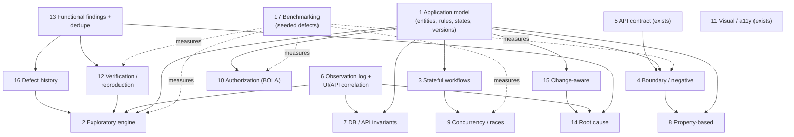

# Capability gap analysis

Phase 0, part C (§3 of the plan, "Identify missing capabilities"). Each of the 17 target capabilities is classified against the code
under `AI_Studio/` as of 2026-11-14. This document builds on `CURRENT_STATE_AUDIT.md` (platform), `EXISTING_INFRASTRUCTURE_MAP.md`
(reuse) and `TEST_GENERATION_QUALITY_AUDIT.md` (pipeline quality); where a conclusion relies on them, the cited code was re-checked.
It adds the parts those audits did not cover in depth: the mobile pipeline, the security module, contracts, visual, accessibility,
healing, quarantine, memory, performance, mutation, the evaluation harness, git import / change detection and issue trackers.

Method: code reading plus a read-only run of seven existing local test files (146 tests, all passing: security findings, phone
quality, quarantine, evaluation metrics, healing rules, API drift, visual baseline). No live application, AI provider or production
system was contacted. The AI-key code (`platform/ai-config*`) was not examined.

## Labels

| Status | Meaning |
|---|---|
| **Existing** | Implemented, wired and reachable; gaps are refinements. |
| **Partial** | Some real building blocks are wired, but the capability as the plan defines it is not delivered. |
| **Missing** | No implementation, or only incidental code that does not serve the capability. |

Effort (one experienced engineer, including tests): **S** under 1 week, **M** 1-3 weeks, **L** 3-6 weeks, **XL** more than 6 weeks.
Value is "for finding real, previously unknown defects in a customer's application", not for regression stability.

## Library check (package.json)

| Library | State | Note |
|---|---|---|
| fast-check (property-based) | Not present | Nothing in `dependencies` or `devDependencies`. |
| Stryker (mutation of source) | Not present | Only relevant to benchmark apps the platform owns; the customer application is a black box. |
| ajv (JSON Schema) | Transitive only | Pulled in by `fastify` and `@modelcontextprotocol/sdk` (`package-lock.json`); not imported by `src/`. Contract checks use an own subset validator (`engine/contracts/check.ts:1-17`). |
| pixelmatch / image diff | Not present | Visual regression uses Playwright's built-in `toHaveScreenshot` comparator (`generators/playwright.ts:248-249`). |
| @axe-core/playwright | Present (direct) | WCAG audits (`engine/a11y/audit.ts`). |
| zod | Present (direct) | Used for every schema; also usable for invariant/rule definitions. |
| Schemathesis, ZAP, nuclei, promptfoo | External binaries | Driven as child processes by `src/security/scanners/*`; not run in hosted mode (see capability 10). |

## Summary table

| # | Capability | Status | Key evidence | Effort | Value | Depends on |
|---|---|---|---|---|---|---|
| 1 | Application intelligence and context modeling | Partial | `understanding/app-model.ts:134-187` (pages, forms, APIs, journeys; no entities/rules/states); `mobile/explore/graph.ts` (screen graph); `memory/*` (structural memory) | L | High (foundation) | none |
| 2 | Intelligent exploratory testing | Partial | Web crawl never submits (`discovery/crawler.ts:313`); objective agent (`agent/objective.ts`); phone map explorer sends forms under safety rules, logcat crash detection (`mobile/explore/map-explorer.ts`, `mobile/quality/*`) | L | Very high | 1, 6, 12 |
| 3 | Stateful workflow testing | Partial | API CRUD chains, off by default (`api/workflows.ts:14-16`, `platform/repo.ts:168`); `remember`/`remembered`; screen map transitions | L | High | 1, cleanup |
| 4 | Boundary and negative testing | Partial | API boundary = `""` and 5,000 chars, `statusBelow 500` only (`api/test-specs.ts:256-272`); field edge generator only behind data-changing tests (`testdata/generate.ts:145,233-266`, `web/author.ts:309`); 7 fixed input probes (`inputs/checks.ts:1-20`) | M | High | 1 (constraints) |
| 5 | API contract testing | Existing | Response schema checks (`contracts/check.ts`), OpenAPI diff (`contracts/diff.ts`, `routes/contracts.ts:42`), live drift (`contracts/drift.ts`, `platform/drift-store.ts`) | S-M | Medium | none |
| 6 | UI/API/backend correlation | Missing (evidence only) | Evidence keeps request metadata, never bodies (`evidence/capture.ts:9-11`); web response checks renderable but not offered to the author (`web/checks.ts:141`); planner forbids API expectations (`planning/planner.ts:107-108`) | M-L | High | observation storage |
| 7 | Database invariant validation | Missing | No connection to the application's data store anywhere in `src/engine`; only "GET returns the created id" round trip (`api/workflows.ts:8-9`) | L-XL | High (where allowed) | 1, 6, runner connector |
| 8 | Property-based testing | Missing | No fast-check; Schemathesis (property-based) only as an external scanner, not hosted; seeded deterministic data generator exists (`testdata/generate.ts:1-7`) | M | Medium | 1, 4 |
| 9 | Concurrency and race-condition testing | Missing | Load check is GET-only, ≤10 users, latency/error budgets (`performance/load.ts:1-21`); Schemathesis stateful checks unreachable | M | High (commerce, quotas) | 3, 13, cleanup |
| 10 | Security and authorization testing | Partial | Passive assessment + full findings lifecycle (`security/findings/ingest.ts:13-24`); vertical role checks for pages and privileged-looking GET endpoints (`identity/access.ts:230,323-397`); no horizontal object-level check; assessment kind hard-coded `passive` (`security/store.ts:641`) | M (BOLA) | Very high | 1 (ownership), accounts |
| 11 | Visual regression and accessibility | Existing | axe WCAG 2.0/2.1 A+AA (`a11y/audit.ts:21`); visual baselines, off by default (`visual/baseline.ts`, `orchestrator.ts:109-110,816`); phone a11y rules (`mobile/quality/a11y.ts`); vision judge opt-in | S | Medium-low | none |
| 12 | Bug reproduction and verification | Partial | Authoring defects stored without a script run (`orchestrator.ts:621-627`); security retest marks fixed (`ingest.ts:21-23`); known-bug tests render `test.fail` (`generators/playwright.ts:305-309`, `platform/job-runner.ts:116`) | M | Very high (precision) | 13 |
| 13 | Duplicate detection | Partial | Security fingerprint upsert (`findings/normalize.ts:139`, `security/store.ts:116`); phone crash dedupe per run (`mobile/quality/explore.ts:61-70`); functional failures have no finding entity | M | High | none |
| 14 | Root-cause analysis | Partial (weak) | LLM triage categories + first wrong step (`validation/repair.ts:21`); prefix classifiers (`validator.ts:508-509`); expected/actual facts (`evidence/failure-facts.ts`); Sentry ranking, "not causation" (`platform/sentry/match.ts`, `related.ts`) | L | Medium | 6, 13, 15 |
| 15 | Change-aware regression testing | Partial | Memory diff of pages/endpoints, used only as an event (`memory/diff.ts`, `memory/session.ts:121-124`); OpenAPI diff; trigger runs store a commit SHA only (`platform/trigger-store.ts:27,153`); runbooks select by suite/tag/type (`runbook-runner.ts:156-178`) | M-L | Medium-high | 1, coverage map |
| 16 | Historical defect intelligence | Partial (data only) | Trends, flaky detection, quarantine, security finding history and sightings, issue links, perf metrics, API snapshots are stored; none feeds planning or exploration | M | Medium | 13 |
| 17 | Testing effectiveness benchmarking | Partial | `src/eval` measures stability, coverage, duplicates, cost (`eval/metrics.ts`); deliberate-fault strength on one assertion (`mutation/faults.ts`); fixtures with planted security/health flaws only (`examples/checks-app`, `examples/security-fixture`) | M | Very high (gates all) | none |

---

## 1. Application intelligence and context modeling — Partial

**What exists**
- `AppModel` (`understanding/app-model.ts:134-164`): pages (path, type, purpose, ARIA snapshot, forms, controls, links, API calls,
  console errors), `ApiEndpointModel` (status codes, inferred response shape, OpenAPI detail), LLM `journeys` (`:119-126`), and
  `AnalysisSchema` (`:167-187`: site type, purpose, features, page purposes, journeys, auth mechanisms).
- Screen map of URL templates and transitions (`screenmap/map.ts`, 296 lines).
- Phone: `MobileAppModel` with a structural screen graph, edges that replayed, untried actions per screen (`mobile/explore/graph.ts`,
  `types.ts`); screens are named by the model only at the end (`map-explorer.ts:11-14`).
- Role reach per account and role differences (`identity/access.ts:215`, `identity/role-differences.ts:18`).
- Requirements as atomic records (`requirements/parse.ts`), linked to tests (`requirement_links`).
- Site memory: a structural, scrubbed record per application with page and understanding fingerprints and a deterministic change
  summary (`memory/distill.ts`, `memory/diff.ts`, `memory/reuse.ts`, table `site_memory`).

**What is missing**
- Entities, attributes, identifiers, ownership, relationships and lifecycles; business rules and invariants; field constraints as
  data; expected outcomes with provenance (requirement / spec / observed / inferred). Confirmed: `AnalysisSchema` has no such fields.
- Versioning: memory keeps one latest record plus a change summary; there is no "application version" that a test or finding is
  bound to. `applications.app_model_json` is overwritten per analysis.
- A link between API response fields and UI fields (shapes are inferred per endpoint, never mapped to what a page shows).

**Reusable**: crawl and network capture, `AppModel` as the container, memory fingerprints (for version identity), the phone screen
graph (already a state graph), requirements store, role reach.

**Effort** L. **Value** high: every oracle-producing capability (3, 4, 7, 8, 9, 10-horizontal) needs entities, constraints or rules.

## 2. Intelligent exploratory testing — Partial

**What exists**
- Web: BFS crawl with menu/tab reveal and conditional-field probing, but it never presses a control whose name matches
  `delete|remove|pay|buy|order|submit|confirm|...|save|...` (`discovery/crawler.ts:313`), so post-action states are not explored.
- Objective agent (`agent/objective.ts`): user-started "pursue this goal" loop; a verdict needs a check behind it (`:125-140`);
  high-impact actions wait for a person (`agent/high-impact.ts`). It reports, it does not hunt for defects on its own.
- Phone (not covered by earlier audits): a model-free map explorer (`mobile/explore/map-explorer.ts`, 994 lines) that tries every
  untried action by priority, walks the shortest path back, detects a plateau, and sends forms filled and empty under
  `safety.ts` rules (never pay, delete, send, call, log out). The model is called only to classify unclear fields, judge whether a
  submit changes data, break a stall, and name screens. A watchdog handles permission dialogs, ANR/crash dialogs and foreign apps.
- Phone quality during exploration (`mobile/quality/explore.ts`): crashes and ANRs from `adb logcat -b crash -b system`
  (`quality/logcat.ts`), cold-start time, per-screen accessibility. On a runner the explore child opens a local device session
  (`agent/explore-child.ts:168` → `openLocalDeviceSession`), which always attaches the monitor (`device/session.ts:211-214`); the
  "not checked" note (`quality/explore.ts:30`) applies to a phone reached through a remote device session.

**What is missing**
- A web exploration loop that acts beyond safe navigation and judges each action with deterministic anomaly oracles (5xx, failed
  request, console error, blank page, error text, unhandled rejection) and keeps a per-action observation log. Today such oracles
  run only as check-family tests on key pages (`health/`), not during exploration.
- Coverage-guided choice of the next action on the web (the phone explorer already does this structurally).
- Hypothesis-driven probing ("this total should equal the sum of lines": needs capability 1).

**Reusable**: phone map explorer design (graph, untried actions, plateau, safety, replay) is the best template for a web explorer;
`web/interpreter.ts` (shared step execution), `BrowserSession`, `frames/*` (live picture), objective agent's high-impact gate and
check-backed verdict rule, `testdata/generate.ts` (tagged, cleanable values), `cleanup/*`.

**Effort** L. **Value** very high: it is the only route to defects present at authoring time (the core weakness in the quality audit).
**Depends on** 1 (what to try), 6 (what to observe), 12 (verify before reporting).

## 3. Stateful workflow testing — Partial

**What exists**: API chains (list → detail always; create → read → update → delete and login → secured only with
`allowMutating`, `api/workflows.ts:14-16`), with value extraction (`request.extract`) and the "GET returns the created id" round trip;
`remember`/`remembered` comparisons across web steps; planner prompt asks for persistence after reload; screen map transitions;
phone "longer journeys" family (`mobile/explore/types.ts:251`). Records created by tests are tagged and cleaned up
(`cleanup/ledger.ts`, `platform/cleanup-store.ts`).

**What is missing**: a state model per entity (allowed and forbidden transitions), tests of invalid transitions (cancel a shipped
order, approve twice), transition coverage, cross-workflow data flow ("created in A, visible in B"). Mutating tests are off by
default (`platform/repo.ts:168`), so even the CRUD chains rarely run.

**Reusable**: workflow chain generator, extraction/interpolation, cleanup ledger, run tags, environments and data sets, test-data
reset hook (`platform/test-data-reset-run.ts`).

**Effort** L. **Value** high (state-transition and persistence defects are two benchmark categories). **Depends on** 1, cleanup.

## 4. Boundary and negative testing — Partial

**What exists**
- API matrix (`api/test-specs.ts`): missing required field → expect 4xx, wrong type → 4xx, then "boundary" = empty string and 5,000
  characters on the first plain string field, judged only as `statusBelow 500` (`:256-272`). Schema `minimum`/`maximum`/`minLength`/
  `maxLength` are not used to place values (only `minimum` as a default valid number, `:47-49`).
- Field edge generator (`testdata/generate.ts:145, 233-266`): accepted and refused values from DOM limits (e.g. one character fewer
  than `minLength`). It is offered to the authoring agent as `testValue` only when data-changing tests are on (`web/author.ts:528`,
  `orchestrator.ts:253`).
- Input probes (`inputs/checks.ts:1-20`): 7 fixed strings on at most 2 safe (GET) forms per key page, plus client-side limit checks.
- Phone: forms sent empty become candidates ("the app must say what is missing", `mobile/explore/candidates.ts:388-391`).

**What is missing**: constraint-driven values on both sides of each limit with a two-sided oracle (inside accepted, outside refused,
same rule in UI and API); numeric/date/currency edges; negative cases that assert the *message* and that nothing was saved.

**Reusable**: the edge generator and OpenAPI parser carry most of what is needed; contract helper already knows min/max/length.

**Effort** M. **Value** high relative to effort (broken validation and boundary failures are benchmark categories).
**Depends on** 1 for UI-side constraints; API-side can start from OpenAPI alone.

## 5. API contract testing — Existing

**What exists**: a dependency-free JSON-Schema subset validator pasted into scripts (`contracts/check.ts:1-17`: type, enum, required,
properties, additionalProperties:false, items, ranges, lengths, pattern, 4 formats; severities); contract findings classified by prefix
(`contracts/specs.ts:22`, `validator.ts:508`); OpenAPI diff with breaking-change markdown (`contracts/diff.ts:124,175`,
`routes/contracts.ts:42`); live shape drift without a spec (`contracts/drift.ts`, `platform/drift-store.ts`, dashboard
`platform/dashboard.ts:361`). Local `drift.test.ts` (29 tests) passes. Schemathesis adapter exists for status/content-type/header/schema
conformance (`security/scanners/schemathesis/adapter.ts:56`).

**What is missing**: `oneOf`/`anyOf` are skipped (`check.ts:9-10`); request-side conformance (the server accepting what the spec
forbids) only via Schemathesis, which does not run hosted; contract checks on traffic seen inside web journeys.

**Reusable** as is. **Effort** S-M. **Value** medium (finds drift and schema breaks, rarely logic defects).

## 6. UI/API/backend correlation — Missing (evidence only)

**What exists**: per-test request/console evidence (`evidence/capture.ts`) with method, path, status, timing, failure, but by design
never bodies or headers (`:9-11`); network capture during discovery folded into endpoint models (`discovery/network.ts`); web tests may
contain `request` + `assertResponse` steps (`web/checks.ts:141`, `WEB_RESPONSE_CHECKS`), but the authoring toolset does not offer them
and the planner forbids API expectations (`planning/planner.ts:107-108`); Sentry "related errors" for a failed run, ranked by path and
time (`platform/sentry/match.ts:18-25`), explicitly not causation (`related.ts:16`).

**What is missing**: a per-action observation record that ties a UI action to the requests it caused and their (redacted) bodies;
assertions "the value shown equals the value the API returned"; detection of swallowed failures (request failed, UI shows success);
any backend signal beyond Sentry.

**Reusable**: evidence redaction functions (reuse for bodies), `BrowserSession` network hooks, `assertResponse` vocabulary, Sentry client.

**Effort** M (observation log + response assertions in authoring) to L (value cross-checks). **Value** high.
**Depends on** new observation storage (noted in P0-B: exploration keeps no per-action log).

## 7. Database invariant validation — Missing

No code connects to the application's data store; the engine sees the application only through browser, HTTP and adb. The closest
things are the API round trip (`api/workflows.ts:8-9`) and the test-data reset hook, which is an HTTP request (`platform/test-data-reset-run.ts`).

**What is missing**: a read-only connector (credentials in the secret box, executed from the runner's network), an invariant language
(SQL query or API query + expected relation), and a schedule (after each mutating step or after a run).

**Reusable**: secret storage, runner task protocol (a new task capability would be needed), environments, zod.

**Effort** L-XL (security review, network placement, per-database drivers; no PostgreSQL/MySQL driver is a dependency today).
**Value** high where customers allow it; a cheaper first step is **API-level invariants** (totals, counts, uniqueness) via
existing request steps. **Depends on** 1 (rules), 6.

## 8. Property-based testing — Missing

No fast-check or equivalent; no generator/shrinker. Schemathesis (property-based over OpenAPI) is wrapped but runs only on a server
with the binary installed and not in hosted mode (`platform/runner-only.ts:68`). `testdata/generate.ts` is a seeded, deterministic value
generator (`:5-7`) that could feed generators.

**What is missing**: properties derived from rules (round trip, idempotent GET, sort order, total = sum), input generators from schemas
and DOM constraints, shrinking of failing inputs, a rendered form that still runs standalone in a downloaded script.

**Effort** M (API-first, using fast-check as a new dev/runtime dependency, or a small own generator to keep scripts dependency-free).
**Value** medium. **Depends on** 1, 4.

## 9. Concurrency and race-condition testing — Missing

`performance/load.ts` sends up to 10 concurrent users of GET requests and judges latency and error rate (`:1-21`); latency checks are
sequential (`performance/latency.ts:1-6`). Schemathesis' stateful checks (`use_after_free`, `ensure_resource_availability`) are
"advanced only" (`schemathesis/adapter.ts:58`) and unreachable (see capability 10). Nothing sends the same mutating request twice in
parallel, double-submits a form, or races two sessions on one record.

**What is missing**: parallel duplicate submission and idempotency checks, two-session conflict tests, double-click on submit, checks of
the outcome (one record, one charge, consistent counter) rather than of status codes.

**Reusable**: load helper's bounded concurrency and stop rules, API workflow chains, cleanup ledger, run tags, high-impact gate.

**Effort** M. **Value** high for commerce/booking/quota apps ("duplicate operations" and "race conditions" are benchmark categories).
**Depends on** 3 (which operations create state), 13 (to report one finding), mutating-test approval.

## 10. Security and authorization testing — Partial

**What exists (security module, not covered in depth before)**
- Passive assessment loop QUEUED → DISCOVERING → SCANNING → VALIDATING → GENERATING_REPORT (`security/assessment/runner.ts`), written
  authorization and scope guard (`authorization.ts`, `scope.ts`), GET-only probes for headers, cookies, CORS, exposed files, listings,
  disclosure, TLS (`assessment/scan.ts:1-5`, `judge.ts`). In hosted mode probes run on the starter's runner
  (`assessment/on-runner.ts`); the loop stays on the server.
- Findings lifecycle (`findings/ingest.ts:13-24`): normalise, redact, group by fingerprint, upsert per application, states
  `confirmed, probable, needs-review, false-positive, fixed, accepted-risk` (`contract.ts:135`), "fixed but seen again" reopens,
  retests mark unseen findings fixed; tables `security_findings`, `security_finding_history`, `security_finding_sightings`
  (`store.ts:116,161`); report and xlsx. `security-findings-unit.test.ts` (19 tests) passes.
- Functional engine: vertical access control by role. Pages a more privileged account reaches become "lesser account cannot open"
  checks (`identity/access.ts:1-16, 240`); API: GET endpoints whose path looks privileged (`PRIVILEGED`, `:230`) are called per token
  and become `statusDenied` checks (`:323-397`).
- Scanners ZAP, nuclei, Schemathesis, promptfoo with profiles `passive | conservative-active | advanced`.

**What is missing or unreachable**
- **Horizontal / object-level authorization (BOLA/IDOR) is not implemented in the product.** Access checks compare accounts on
  privileged-looking paths only; nothing substitutes another account's object id. Schemathesis' `object_level_authorization` and
  `ignored_auth` are advanced-only (`schemathesis/adapter.ts:58`), and an assessment is always created with kind `"passive"`
  (`security/store.ts:641`; the start body accepts only `retestOf`, `routes/assessments.ts:111`). So the advanced profile cannot be
  started from the API today: **present but unused**.
- External scanners do not run in hosted mode (`platform/runner-only.ts:68`, `routes/assessments.ts:66-70`).
- Mutating authorization (can B update/delete A's record), privilege escalation via mass assignment, session handling tests.

**Reusable**: role sign-in helpers and API tokens per account (`access.ts`), the API model's id-bearing paths and response ids
(`api/workflows.ts` consumer detection), the findings lifecycle as the template for functional findings.

**Effort** M for a read-only horizontal check (two accounts of the same role, ids observed for A, requested as B, expect 401/403/404 or
no A data). **Value** very high (missing authorization is a top benchmark category and a common real defect). **Depends on** 1 (which
ids belong to whom; a heuristic from observed traffic suffices first).

## 11. Visual regression and accessibility — Existing

**What exists**: axe-core audits at WCAG 2.0/2.1 A+AA with an impact threshold (`a11y/audit.ts:18-31`), on by default for key pages
(`orchestrator.ts:85-86,722`); visual baselines with a stability re-run and review/accept flow (`visual/baseline.ts:1-14`), off by default
(`orchestrator.ts:109-110`), `maxDiffPixels` 100; signed-in variants; vision "looks right" judge, opt-in by level (`orchestrator.ts:98-104`);
phone accessibility from the UI Automator dump: unlabeled touchables, image buttons without description, targets under 48 dp,
duplicate labels (`mobile/quality/a11y.ts:1-13`), with contrast and text size explicitly not checked.

**What is missing**: masking of dynamic regions (a page with a clock or carousel is declared unbaselinable rather than masked);
phone visual baselines; contrast on phones; a11y inside journeys (only key pages).

**Effort** S. **Value** medium-low for the plan's goal (finds real but low-severity defects; visual baselines are change detectors).

## 12. Bug reproduction and verification — Partial

**What exists**
- New failing web tests are re-run once and passing ones `repeatPasses` times (`validator.ts:378-404`).
- Security retests: open findings not seen again become fixed (`findings/ingest.ts:21-23`).
- Phone quality tests are stored as "Needs a look" with the facts seen and re-checked on the device whenever run (`mobile/quality/create.ts:1-5`).
- Known bugs: a test linked to an issue renders `test.fail(...)`, so a pass says "seems fixed" (`generators/playwright.ts:305-309`,
  `platform/job-runner.ts:112-124`). The tracker's own state is never read: a link stays open until a person removes it.
- Healing proposals only, never applied automatically (`healing/heal.ts:1-11`).

**What is missing**: execution of authoring-time defects as scripts before reporting (they are stored as NEEDS_REVIEW without a run,
`orchestrator.ts:621-627`; verified by the quality audit); verification by re-execution rather than a 3-vote LLM verdict; reproduction
on a clean session and across browsers/data; step minimisation; recorded preconditions (data, account, environment).

**Reusable**: validator re-run machinery, variants (`validation/variants.ts`), runner tasks, traces/video, the security retest pattern.

**Effort** M. **Value** very high: precision decides whether people trust findings. **Depends on** 13 (a finding to verify).

## 13. Duplicate detection — Partial

**What exists**: security fingerprint `category + check + rule + normalised location` (`findings/normalize.ts:139`), unique per application,
upsert with sightings; phone crashes deduplicated within a run by kind + exception + screen with a count (`mobile/quality/explore.ts:61-70`);
planner removes lexical duplicates (quality audit, `planner.ts:256-259`); eval counts duplicate tests; issue creation dedupes per test +
tracker only (`routes/integrations.ts:147`).

**What is missing**: a functional finding entity (P0-B: failures are tests in NEEDS_REVIEW); fingerprints for functional failures
(endpoint + status, page template + console signature, assertion + element), across tests and runs; similarity for near duplicates.

**Reusable**: the security findings model and ingest almost verbatim (fingerprint, upsert, history, sightings, redaction, states).

**Effort** M. **Value** high (ten tests hitting one 500 must be one finding). **Depends on** none; enables 12, 14, 16.

## 14. Root-cause analysis — Partial (weak)

**What exists**: LLM triage into `locator | timing | test_data | assertion | app_defect | environment | other` with the first wrong step
(`validation/repair.ts:21`); deterministic finding classifiers by message prefix (`validator.ts:508-509`); expected/actual extraction
from Playwright errors (`evidence/failure-facts.ts`); phone crash stack from logcat, secrets scrubbed (`mobile/quality/logcat.ts`);
phone infrastructure failures separated from app failures (`mobile/device/infra.ts`); Sentry related issues ranked by checkable evidence.

**What is missing**: attribution to a layer (UI rendering vs API response vs backend error), grouping of symptoms under one cause,
first-failing version/commit, use of the per-action observations that do not yet exist.

**Effort** L. **Value** medium (helps triage speed more than discovery). **Depends on** 6, 13, 15.

## 15. Change-aware regression testing — Partial

**What exists**: memory change summary of pages added/removed/changed and endpoints (`memory/diff.ts`), which is emitted as an event
(`memory/session.ts:121-124`) and not used to choose tests; exploration reuse skips unchanged pages for the model (`memory/reuse.ts`);
OpenAPI diff and API drift; deploy triggers that store a commit SHA (`platform/trigger-store.ts:27,153`) and a CLI for CI; runbook
selection by ids, suite, tag, type (`platform/runbook-runner.ts:156-178`); git import of hand-written Playwright files with provenance and
a line-count diff on refresh (`engine/gitimport/provenance.ts`, `platform/git-import-service.ts`). Nothing reads a source diff.

**What is missing**: a coverage map (test → pages, controls, endpoints it touches), change → impacted tests selection and ordering,
targeted exploration of changed pages, use of the commit or a code diff.

**Reusable**: memory fingerprints, spec steps (paths and endpoints are in the spec), drift, triggers, runbooks.

**Effort** M for UI/API-change-driven selection, L with source diffs. **Value** medium-high (cheaper and faster regression; new pages
explored first). **Depends on** 1 (versioned model) and a coverage map.

## 16. Historical defect intelligence — Partial (data only)

**What exists (stored)**: test executions and steps, run summaries and pass-rate trends, flaky detection (`platform/trends.ts`),
quarantine (`quarantine/rules.ts`; check-family tests never eligible, consistent failures not eligible), security finding history and
sightings, issue links, perf metrics history, API snapshots, healing proposals.

**What is missing**: any use of that history in planning or exploration (no reference in `planning/` or `understanding/`), defect-prone
area scoring, recurring-failure patterns, reading tracker state (fixed / won't fix).

**Effort** M. **Value** medium (prioritisation). **Depends on** 13 (findings with identity across runs).

## 17. Testing effectiveness benchmarking — Partial

**What exists**: the evaluation harness drives the real API end to end (`eval/harness.ts:1-8`) and computes first-pass, stable, flaky,
duplicates, coverage, product-vs-test-wrong failures by a reason heuristic, AI calls, tokens, cost (`eval/metrics.ts`); `eval_runs`
table, comparison (`eval/compare.ts`); corpus has two local fixtures (`eval/corpus.json`). Deliberate-fault "test strength"
(`mutation/strength.ts`, `faults.ts`): all-500, empty responses, changed literal, hidden element, on the last content assertion only.
Fixtures with planted problems: `examples/checks-app` (`weak` / `hardened` / `spa` modes) and `examples/security-fixture` (reflected
input, exposed secret, listing, OpenAPI). `eval-unit.test.ts` (15 tests) passes.

**What is missing**: a seeded-defect corpus for functional categories (calculations, validation, state transitions, authorization,
duplicates, races, persistence, boundaries, visual); "known / detected / missed / false positive" metrics; Stryker-style mutation of a
benchmark app's source (Stryker would fit the platform-owned TypeScript fixtures, not customer apps); repeatability controls (no
temperature/seed in planning or authoring, per the quality audit).

**Reusable**: harness, client, fixtures host, metrics shape, the `weak`/`hardened` paired-fixture pattern.

**Effort** M. **Value** very high: without it no other change can be shown to improve bug finding. **Depends on** none.

---

## Hosted-mode reach (EXECUTION_MODE=runners)

| Piece | Runs hosted? | Evidence |
|---|---|---|
| Functional checks (access, contract, input, a11y, visual, health) | Yes, in the starter's runner | P0-B; same engine on the runner |
| Phone exploration with crash/ANR/start-up checks | Yes, local device session on the runner | `agent/explore-child.ts:168`, `device/session.ts:211-214` |
| Security passive probes | Yes, on the runner; loop on the server | `security/assessment/on-runner.ts`, `routes/assessments.ts:66-70` |
| ZAP, nuclei, Schemathesis, promptfoo | No | `platform/runner-only.ts:68` |
| Advanced/active security profiles | Not reachable in any mode | `security/store.ts:641`, `routes/assessments.ts:111` |
| Sentry lookups, issue filing | Server | `platform/sentry/*`, `platform/issues/*` |

## Dependency graph

## Highest value per effort

1. **Seeded-defect benchmark and "found k of n" metric** (17; M). Reuses the harness and the paired weak/hardened fixture pattern.
   Required to show that anything below helps.
2. **Functional findings with fingerprint and dedupe** (13; M). Port of the security findings lifecycle; turns NEEDS_REVIEW tests
   into findings with identity, sightings and states.
3. **Verify by re-execution before reporting** (12; S-M). Run authoring-time defects as scripts, replay on a clean session, demote on
   pass; drop reliance on the LLM vote for the final decision.
4. **Horizontal authorization (BOLA) check, read-only** (10; M). Two accounts, ids observed for one requested as the other; reuses
   `identity/access.ts` sign-in and token plumbing. Also make the advanced Schemathesis profile startable where scanners run.
5. **Constraint-driven boundary and negative oracles** (4; S-M). Use OpenAPI and DOM limits on both sides of each limit; assert refusal
   and "nothing saved", not only "no 5xx".
6. **Response assertions and a per-action observation log in web authoring** (6; M). Offer the existing `assertResponse` checks to the
   author, capture redacted bodies per action.
7. **Duplicate-submission / idempotency checks** (9; M), after 3 and 13, behind the data-changing approval.

Larger, foundational items to schedule after the above prove their value on the benchmark: application model with entities, rules
and versions (1; L), stateful web exploration modelled on the phone map explorer (2; L), state-machine workflows (3; L), change-aware
selection (15; M-L), defect history in planning (16; M), root-cause attribution (14; L), database invariants (7; L-XL, API-level
invariants first), property-based generation (8; M).
