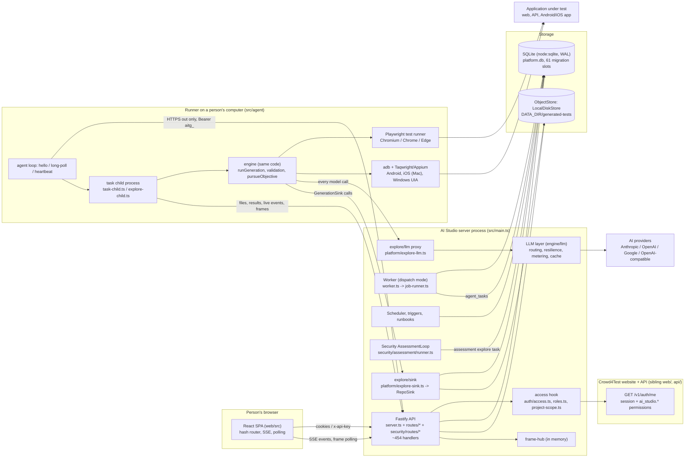
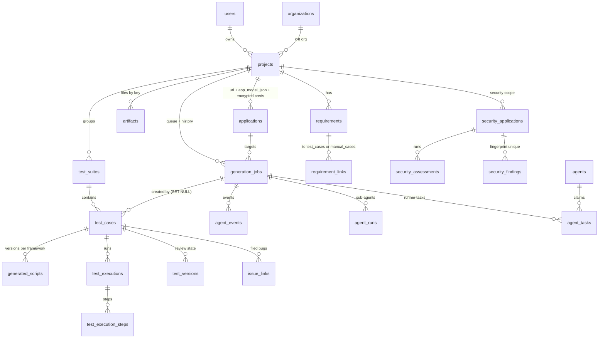

# AI Studio: current state audit (platform and infrastructure)

Phase 0, part B. Scope: the platform around the test-generation pipeline: frontend, backend modules and routes, database, LLM
integration, execution engine and framework adapters, browser/API/mobile testing, the security module, the local runner, evidence and
reporting, agent orchestration, jobs and queues, auth and project isolation, and integrations. The pipeline itself (prompts, scenario
quality, assertions) is audited in depth in `TEST_GENERATION_QUALITY_AUDIT.md`; here it appears only at architecture level.

Method: every statement below was checked in the code under `AI_Studio/` as of 2026-11-14 (working tree, `main` = d4e5e96 plus the
uncommitted round that introduces organisational and personal AI keys). Comments and `docs/` were used only as pointers. Nothing was
run against a live application, a real AI provider or production. The test suite was not run for this audit (see "Not verified").

## Classification used

| Label | Meaning |
|---|---|
| **Implemented** | Code path exists end to end, is wired into the server, worker or runner, and is reachable from the UI or API. |
| **Partial** | Works, but a documented part of it is missing, limited, or not reachable in every deployment mode. |
| **Present, unused** | Code exists but nothing in the running product calls it (or it is off in the hosted deployment). |
| **Mocked / simulated** | Production code that fakes a result. None was found (see section 14). |
| **Planned** | Referenced in code or docs, not built. |
| **Unverified** | Code exists and looks complete, but correctness depends on hardware, external services or tests this audit did not run. |

## 1. Main components and data flow

Key facts the diagram encodes (all verified):

- **One server process, one database file.** `src/main.ts` builds the Fastify server and, depending on configuration, an embedded worker, a
  dispatch worker, the scheduler and the security assessment loop in the same process. `src/worker-main.ts` is an optional separate worker
  process on the same SQLite file.
- **The hosted deployment runs nothing on the server.** `deploy/c4t-box/deploy.sh:140` writes `EXECUTION_MODE=runners` and
  `WORKER_EMBEDDED=false`. In that mode `LocalExecutor` refuses every script run (`engine/frameworks/executor.ts`, `refuseLocalExecution`),
  and every job mode (`validate`, `variants`, `environment`, `generate`, `plain`, `agent`: `platform/runner-only.ts:33`) is dispatched to the
  starter's own runner.
- **The AI stays on the server.** An exploration on a runner runs the engine there, but its model is a remote `LlmClient`
  (`agent/remote-llm.ts`) whose `doGenerate` posts the AI SDK call options to `POST /api/agent/tasks/:id/explore/llm`
  (`agent-protocol/explore-llm.ts`); the server runs the call on the job's configured model. No key reaches the runner.
- **Persistence stays on the server.** The engine writes through the `GenerationSink` interface (`engine/orchestrator.ts:~145`). On a runner
  the sink is `agent/remote-sink.ts`, which batches calls to `POST .../explore/sink`, applied by `platform/explore-sink.ts` to the job's
  `RepoSink`. The runner never invents a database id.

## 2. Module-by-module state

### 2.1 Frontend (web/src)

| Area | Where | State | Notes |
|---|---|---|---|
| App shell, routing | `web/src/main.tsx`, `lib/router.ts`, `lib/aliases.ts`, `components/Shell.tsx` | Implemented | React 18 SPA built with Vite, hash routing (`#/projects/:id/...`), no state library; data via `lib/hooks.ts` + `api.ts`. Old links redirected by `aliases.ts`. |
| Project places | `features/workspace/*`, `pages/ProjectOverview.tsx`, `components/ProjectHub.tsx` | Implemented | Lifecycle order: Overview, Requirements, Test cases, Test scripts, Test suites, Agent runs, Runs, Settings; plus Security, Recorder, Write code. |
| Runs and live progress | `features/runs/*` (2.1k lines), `features/explorer/*`, `lib/stream.ts` | Implemented | Job events over SSE (`platform/stream-core.ts`, `routes/stream.ts`, ticketed); Explorer picture is polled from the in-memory frame hub. |
| Global places | Dashboard, Libraries, Integrations, Testing agents, Settings, Profile, Guide | Implemented | `features/guide` (4.5k lines) is the in-app guide and tour. |
| Security UI | `features/security/*` (3.9k lines) | Implemented | Separate section under `#/projects/:id/security/...`. |
| AI keys UI | `features/aiconfig/*` | Being changed | Organisational and personal keys, one chosen per person (other agents' work in progress). |
| `components/Planned.tsx` | | Present, unused | A placeholder for places whose backend is not built; no page renders it today. |

Size: `web/src/features` is ~48.5k lines across 58 feature folders, `web/src/pages` ~1.9k.

### 2.2 Backend server and API routes

| Area | Where | State | Notes |
|---|---|---|---|
| Server bootstrap | `src/main.ts`, `platform/bootstrap.ts`, `platform/server.ts` | Implemented | `bootstrap()` opens `Db`, `Repo`, `SecretBox`, `ObjectStore`, the default `LlmClient`, installs gates (runner-only, framework, custom scripts, plug-ins). |
| Core routes | `platform/server.ts` (~30 handlers: projects, test-generation, specs, tests, artifacts, JUnit, download) | Implemented | `POST /api/projects/:id/test-generation` creates a generation job. |
| Feature routes | `platform/routes/*.ts` (64 files) via `routes/index.ts` | Implemented | Largest: manual cases, schedules, suites, requirements, libraries, runbooks, environments, custom scripts, auth, AI config. |
| Security routes | `security/routes/*.ts` under `/api/v1/security/...` | Implemented | Assessments, findings, scanners, sign-in, notifications. |
| Runner protocol routes | `/api/agent/hello, poll, enroll, rotate, update, check, tasks/:id/{accept,reject,heartbeat,events,files,result,recording,device,explore/llm,explore/sink,explore/frame}` | Implemented | 19 routes, Bearer `aitg_` token, own credential (bypass the person ACL). |
| Ops | `platform/ops/*`: `/api/health`, `/readyz`, `/metrics` (Prometheus), structured logs, backups, graceful shutdown | Implemented | Secrets scrubbed from log lines (`ops/logger.ts`). |
| Route permission table | `auth/roles.ts`, tests that fail on an unclassified route | Implemented | Fail-closed: an unknown route is "all projects only". |

Total: ~454 `app.get/post/put/patch/delete` handlers across `src/platform` and `src/security`.

### 2.3 Database

| Area | Where | State | Notes |
|---|---|---|---|
| SQLite runtime | `platform/db.ts` (`node:sqlite` `DatabaseSync`, WAL, foreign keys, busy timeout) | Implemented | 61 numbered migration slots in one ordered array; slot 61 (two kinds of AI keys) is in the uncommitted round. Late-filled slot repair for slots reserved before their SQL existed. |
| Async SQL interface | `platform/sql.ts` (`Sql` with `get/all/run/tx`), `sql-dialect.ts` | Partial | Stage M1 of a SQLite to PostgreSQL migration. Only a SQLite adapter exists; ~29 files use the async `Sql`, ~81 still call the synchronous `db.get/all/run/tx`. Transaction bodies must await only the database (`SqlTxRuleError`). |
| PostgreSQL schema | `platform/pg/baseline.sql` (133 tables, equal to slots 1-57) | Present, unused | No PostgreSQL adapter or driver dependency in `package.json`; used only by a unit test that compares it with a fresh SQLite schema. |
| Schema | ~130 tables | Implemented | See section 3 for the main groups and relationships. |

### 2.4 LLM integration

| Area | Where | State | Notes |
|---|---|---|---|
| Provider abstraction | `engine/llm/provider.ts` (`LlmClient`: `object` (zod-validated), `text`, optional `imageObject`) | Implemented | Vercel AI SDK v6 (`ai`, `@ai-sdk/anthropic|openai|google`) plus an OpenAI-compatible endpoint for self-hosted models. Structured output through zod schemas. No mock mode in production. |
| Resilience | `engine/llm/resilience.ts`, `errors.ts`, `health.ts`, `platform/llm-health.ts` | Implemented | Fallback chain, provider pause shared between processes, typed errors with scrubbed details. |
| Routing | `engine/llm/routing.ts`, `platform/llm-routing.ts` | Implemented | `fast`/`main`/`strong` targets by purpose; escalation from the fast model on repeated or failing actions; a separate planning/review model. |
| Metering and budgets | `engine/llm/metered.ts`, `usage.ts`, `platform/usage-store.ts` | Implemented | Every call labelled by purpose (`analysis, planning, review, authoring, repair, vision, plain, other`), counted and checked against budgets before it is made. |
| Prompt caching | `engine/llm/prompt-cache.ts`, `platform/prompt-cache-settings.ts` | Implemented | Provider-specific cache styles; cache read/write tokens recorded. |
| "Without AI" switches | `engine/llm/without-ai.ts` | Implemented | Deterministic repair first; exploration reuse of unchanged pages. |
| Key management | `platform/ai-config*.ts`, `routes/ai-config.ts`, `features/aiconfig` | Being changed | Two kinds of keys (organisational, personal), one chosen per person; resolved per job by `resolveAiFor` in `job-runner.ts:jobLlm`. Not audited here. |
| Remote LLM for runners | `agent/remote-llm.ts`, `agent-protocol/explore-llm.ts`, `platform/explore-llm.ts` | Implemented | See section 1. Call cap 5000 per task attempt, 16 MB body cap. |

### 2.5 Test-generation pipeline (architecture level only)

`engine/orchestrator.ts` `runGeneration`: discovery (`discovery/crawler.ts`, `network.ts`, `auth.ts`, `docs.ts`) -> understanding
(`understanding/analyzer.ts` -> `AppModel`) -> planning (`planning/planner.ts`) -> generation (web: `web/author.ts` tool-calling agent in a
real browser; API: deterministic `api/test-specs.ts`, `api/workflows.ts` from OpenAPI and observed traffic; plus deterministic families:
a11y, health, security headers, input checks, access control, visual baselines, performance, load) -> validation
(`validation/validator.ts`: render -> run -> triage -> repair, up to N attempts) -> strength measurement (`mutation/strength.ts`).
Mobile: `mobile/explore/pipeline.ts`. Plan-then-create: `platform/plan-store.ts`. State: **Implemented**; quality is assessed in the
companion audit.

### 2.6 Execution engine and framework adapters

| Adapter id | Where | Runs on | State |
|---|---|---|---|
| `playwright` (web) | `engine/frameworks/builtin.ts`, `generators/playwright.ts`, `validation/runner.ts` | Node + Chromium (runner: bundled Chromium or installed Chrome/Edge) | Implemented |
| `playwright-api` | same, `generators/api.ts` | Node | Implemented |
| `taqwright` (Android, Appium-style on the Playwright runner) | `builtin.ts`, `generators/taqwright.ts`, `validation/mobile-runner.ts`, `@taqwright/taqwright` 1.2.0 (Apache-2.0) | Android emulator or device with SDK | Implemented; Unverified on real devices in this audit |
| `taqwright-ios` | `frameworks/ios.ts`, `mobile/ios-runner.ts`, `ios-simulators.ts` | Mac runner with Xcode, simulator, XCUITest driver | Implemented; Unverified (needs a Mac) |
| `windows-uia` | `frameworks/windows.ts`, `generators/windows.ts`, `engine/desktop/*` | Windows runner, non-elevated session, app allow-list | Partial: adapter and spec kind `desktop` exist, but a project's platform can only be `web`, `android` or `ios` (`platform/project-setup.ts` `PlatformsSchema`), so desktop is not a selectable project type |
| Adapter plug-ins | `frameworks/plugin-loader.ts`, `plugin.ts`, `examples/adapter-plugin` | Off unless `ALLOW_ADAPTER_PLUGINS=true` with an API key | Implemented, off by default |

The seam: `FrameworkAdapter { render, execute, needs, traits }` in `frameworks/types.ts`, an `AdapterRegistry` (`registry.ts`), and a
`ScriptExecutor` chosen per job by `executorFor(scope)` (`executor.ts`). `platform/agent-services.ts:1780` installs the resolver that
returns a remote executor for projects that route to a runner. Device choice (farm, several phones) wraps the executor
(`mobile/cloud/farm-executor.ts`). Web scripts run in one `playwright test` child process with a JSON reporter, a partial-results reporter
(cancel-safe), a live reporter (per-step events), failure screenshots, traces (`retain-on-failure-and-retries`) and failure videos
(`validation/runner.ts:147-177`). Results are only "passed" if Playwright says so.

### 2.7 Browser automation

| Piece | Where | State |
|---|---|---|
| Browser lifecycle, aria snapshots | `discovery/browser.ts` (`BrowserSession`, `launchChromium`, `ariaSnapshot`, `settle`) | Implemented |
| Crawler (BFS, same origin, sitemaps, menus, tabs, "load more") | `discovery/crawler.ts` (734 lines) | Implemented |
| Network capture to API models | `discovery/network.ts` | Implemented |
| Unattended sign-in (incl. TOTP) | `discovery/auth.ts`, `engine/auth/*`, saved sessions (`platform/hard-signin-service.ts`), test mailbox (`platform/mailbox/*`) | Implemented |
| Step interpreter (live) | `web/interpreter.ts` (`executeStep`, `locate`) | Implemented; shared by authoring, agent runs, recorder, live sessions, repair |
| Recorder | `engine/recorder/*`, `platform/recorder-service.ts`, runner `record-task.ts` | Implemented |
| Address guard for driven browsers | `discovery/guard-proxy.ts`, `platform/net-guard.ts`, runner `address-guard.ts` | Implemented |
| Cross-browser / viewport variants | `validation/variants.ts` | Implemented |
| Visual baselines, vision judgement | `visual/baseline.ts`; `vision/*` (opt-in `visionChecks`) | Implemented (vision opt-in) |

### 2.8 API testing

| Piece | Where | State |
|---|---|---|
| OpenAPI 3 / Swagger 2 ingestion | `engine/api/openapi.ts` | Implemented |
| Endpoint scenario matrix (happy, missing field, wrong type, unauthenticated...) | `engine/api/test-specs.ts` | Implemented, deterministic |
| Multi-request workflows (create -> read -> delete, value extraction) | `engine/api/workflows.ts`, `request.extract` in `spec/schema.ts` | Implemented |
| OAuth2 client credentials | `engine/api/oauth.ts` | Implemented |
| Contract checks against documented schema | `engine/contracts/check.ts` (JSON-Schema subset, no LLM) | Implemented |
| OpenAPI diff, live drift without a spec | `contracts/diff.ts`, `contracts/drift.ts`, `platform/drift-store.ts` | Implemented |
| API access control by role | `identity/access.ts` (`surveyApiAccess`) | Implemented |
| Load check (bounded) | `performance/load.ts`, `platform/load-guard.ts` | Implemented, refused for production |
| Record cleanup after mutating tests | `engine/cleanup/*`, `platform/cleanup-store.ts` | Implemented |

### 2.9 Mobile

| Piece | Where | State |
|---|---|---|
| Device layer: adb, uiautomator dumps, actions, readiness, emulator start | `engine/mobile/device/*`, `emulator.ts`, `toolchain.ts` | Implemented; Unverified on hardware here |
| AI exploration of an Android app | `engine/mobile/explore/*` (explorer, map-explorer, planner, spec-builder, safety, sign-in with a person gate) | Implemented |
| Quality checks (a11y, logcat, startup, monitor) | `engine/mobile/quality/*` | Implemented |
| Repair without AI | `engine/mobile/repair/*` | Implemented |
| Clean start, permissions, AAB conversion | `engine/mobile/state/*` | Implemented |
| Device sessions on a runner | runner `device-task.ts`, `platform/agent-device.ts`, `phone-device.ts` | Implemented |
| Device farms (BrowserStack, Sauce Labs, LambdaTest, generic Appium) | `engine/mobile/cloud/*`, `platform/device-farm-*.ts` | Implemented; Unverified against live farms (WebDriver from the server) |
| iOS | see 2.6 | Implemented; Unverified |

`engine/mobile` is the largest engine module (~13k lines).

### 2.10 Security module (src/security, ~13k lines)

| Piece | Where | State |
|---|---|---|
| Applications, written authorization, scope guard | `security/store.ts`, `authorization.ts`, `scope.ts` (803 lines) | Implemented |
| Passive assessment loop (QUEUED -> DISCOVERING -> SCANNING -> VALIDATING -> GENERATING_REPORT) | `security/assessment/runner.ts` (`AssessmentLoop`), `discover.ts`, `probe.ts`, `judge.ts` | Implemented; restart-safe |
| Assessment on the starter's runner (hosted mode) | `security/assessment/on-runner.ts`, explore task mode `assessment` | Implemented |
| Findings lifecycle: normalise, fingerprint dedupe, history, sightings, redaction, report, xlsx | `security/findings/*`, tables `security_findings`, `security_finding_history`, `security_finding_sightings` | Implemented |
| External scanners: ZAP, Nuclei, Schemathesis, promptfoo | `security/scanners/*` (adapters, binaries lookup, process control, profiles) | Partial / Present, unused in the hosted mode: binaries must be installed by an administrator, and with `EXECUTION_MODE=runners` they are left out (`platform/runner-only.ts:68` `SCANNERS_NOT_ON_RUNNER`, `security/routes/assessments.ts:70`) |
| Passive read-only checks in functional exploration | `engine/security/checks.ts`, `specs.ts` | Implemented |

Note: security has its own `security_applications` table, separate from the functional `applications` table.

### 2.11 Local runner (src/agent + src/agent-protocol)

| Piece | Where | State |
|---|---|---|
| Wire contract (one file shared by both sides) | `agent-protocol/schema.ts` (987 lines, `PROTOCOL_VERSION = 2`, supports 1 and 2) | Implemented |
| Connect out only, long-poll, heartbeat, lease | `agent/agent.ts`, `client.ts`, `beat-pacer.ts`, `backoff.ts` | Implemented |
| Protocol 2: attempt ids, accept/reject, live events, durable results, outbox | `agent/outbox.ts`, `live-events.ts`, `platform/agent-store.ts` (`agent_task_events`) | Implemented |
| Task kinds: `run`, `record`, `device`, `explore` (modes `generate`, `plain`, `agent`, `mobile`, `assessment`) | `agent/task-runner.ts`, `task-child.ts`, `explore-child.ts`, `record-task.ts`, `device-task.ts` | Implemented |
| A child process per task, whole-tree kill on cancel | `agent/task-process.ts`, `cleanup.ts` | Implemented |
| Explore on runner with platform-side AI and sink | `remote-llm.ts`, `remote-sink.ts`, `explore-transport.ts` | Implemented; survives a platform restart (`explore_task_state`, slot 58) |
| Watch live frames from a runner | `remote-frames.ts`, `/explore/frame`, `platform/frame-hub.ts` | Implemented |
| Enrollment codes, credential in OS store (DPAPI / Keychain / 0600 file) | `agent/credential-store*.ts`, `/api/agent/enroll`, `/rotate` | Implemented |
| Signed self-update | `agent/updater.ts`, `agent-protocol/update-manifest.ts`, `platform/runner-update.ts` | Implemented |
| Kits and installers (Windows, macOS .pkg, Linux) | `platform/runner-kit*.ts`, `runner-mac-pkg.ts`, `runner-linux-script.ts`, `installer/` | Implemented |
| Browser provisioning on the runner | `agent/browser-setup.ts`, `engine/browsers/*` | Implemented |
| Capabilities, computer check | `agent/capabilities.ts`, `computer-check.ts` | Implemented |
| One runner per person | `platform/agent-store.ts` (slot 57 reset), `agent-routing.ts` | Implemented (team runners removed) |

### 2.12 Logs, artifacts, evidence, reporting

| Piece | Where | State |
|---|---|---|
| Job events (structured, no model reasoning) | `EngineEvent` in `engine/context.ts`; `agent_events` table; SSE stream | Implemented |
| Agent runs per generation sub-agent | `agent_runs` table (`GenerationSink.startAgentRun/finishAgentRun`); individual tool calls (`agentAction`) are not stored, and the `agent_actions` table was dropped in migration slot 63 | Implemented (runs only) |
| Artifacts | `artifacts` table + `ObjectStore` (`platform/object-store.ts`, `LocalDiskStore`) | Implemented (local disk); S3 store Planned (M4) |
| Failure evidence (requests, console) captured inside scripts | `engine/evidence/capture.ts`, `model.ts` (`sanitizeEvidence`), `summary.ts`, `failure-facts.ts`, `platform/evidence-read.ts` | Implemented |
| Trace scrubbing of secrets | `engine/evidence/trace-scrub.ts` (refuses a trace it cannot clean) | Implemented |
| Reports | `platform/reports/junit.ts`, `project-report.ts` (HTML/PDF), `release-report.ts` | Implemented |
| Trends, flaky detection, run summaries, dashboard | `platform/trends.ts`, `dashboard.ts`, `run_summaries` | Implemented |
| Severity of application findings | `engine/validation/severity.ts` (deterministic, on read) | Implemented |
| Metrics, logs | `platform/ops/metrics.ts`, `ops/logger.ts` | Implemented; no distributed tracing |
| Retention, backups | `engine/retention/*`, `platform/retention-*.ts`, `platform/backup.ts` | Implemented |

### 2.13 Agent orchestration

There is no general multi-agent framework. "Agents" are four concrete tool-calling loops on the AI SDK (`generateText` with `tools`):

| Loop | Where | State |
|---|---|---|
| Web authoring agent (scenario -> validated spec by acting in a real browser) | `engine/web/author.ts` | Implemented |
| Objective agent ("pursue this goal", verdict needs a check, high-impact actions wait for a person) | `engine/agent/objective.ts`, `high-impact.ts`; `platform/agent-run*.ts`; tables `objective_runs`, `objective_run_steps`, `objective_run_approvals` | Implemented |
| Phone explorer | `engine/mobile/explore/explorer.ts`, `map-explorer.ts` | Implemented |
| Plain-English authoring | `engine/authoring/plain.ts`, `platform/plain-run.ts` | Implemented |

"Testing agents" (`platform/testing-agents.ts`) are named presets over existing exploration switches (API, accessibility, security,
responsive UI, UX, performance, test case generation), not separate programs. Runbooks (`platform/runbook-runner.ts`) chain existing jobs
step by step.

### 2.14 Jobs and queues

| Piece | Where | State |
|---|---|---|
| Job table as queue | `generation_jobs` (status, lease_until, lease_owner, attempts, cancel_requested); `Repo.claimNextJob` (`UPDATE ... WHERE id = (SELECT ... ORDER BY created_at LIMIT 1)`) | Implemented; no external broker |
| Job modes | `generate`, `validate`, `variants`, `environment`, `plain`, `agent` (`repo.ts:161`), dispatched in `job-runner.ts:runJobAs` | Implemented |
| Worker | `platform/worker.ts`: plain (1 slot) or dispatch (`DISPATCH_CONCURRENCY`, default 8), lease heartbeat every 5 s, stale-job reclaim, disk-space wait, `JOB_MAX_MINUTES` | Implemented |
| One active job per project | `scheduler.ts:activeJobOf` (checked when a job is made) | Implemented |
| Runner task queue | `agent_tasks`, `agent_task_events`, `agent_task_files`; offer on long-poll; lease; re-offer; hand-over across a platform restart (`runner-handover.ts`) | Implemented |
| Ordered writes per job | `platform/job-write-queue.ts`, `repo-sink.ts` | Implemented |
| Scheduler, deploy triggers, runbooks | `scheduler.ts`, `schedule-*.ts`, `trigger-store.ts`, `runbook-*.ts` | Implemented |
| Security assessment queue | its own loop and table (`security_assessments`), same lease pattern | Implemented |

### 2.15 Auth, authorization, project isolation

| Piece | Where | State |
|---|---|---|
| Access hook in front of every `/api` route | `auth/access.ts` | Implemented |
| Crowd4Test sign-in (parent-domain cookies, checked with `GET /v1/auth/me`, cached) | `auth/crowd4test.ts`; codes shared with `api/src/config/permissions.ts` | Implemented |
| Local accounts, sessions, CSRF cookie, scrypt passwords, sign-in throttling, OIDC (RS256, PKCE) | `auth/cookies.ts`, `password.ts`, `limiter.ts`, `oidc.ts`, `platform/user-store.ts` | Implemented |
| Shared API key and personal tokens (`aitpu_`) | `auth/access.ts` | Implemented |
| Permission catalogue (`ai_studio.access`, `.tests.generate`, `.tests.run`, `.agent.run`, `.security.use`, `.runners.manage`, `.ai_keys.manage`, `.usage.view`, `.platform.settings`, ...) | `auth/permissions.ts`, route table `auth/roles.ts` | Implemented |
| Per-project scope (project / object / list / query / ticket / none / all), 404 for out-of-reach objects, organisation rule for customers | `auth/project-scope.ts`, `platform/project-access-store.ts` | Implemented |
| Cost hiding from testers and people without `usage.view` | `auth/cost-hiding.ts` | Implemented |
| Runner isolation | per-person runner; tasks offered only to the owner's runner (`agent_tasks.owner_id`); private-address rule on the runner | Implemented |

### 2.16 Integrations

| Integration | Where | State |
|---|---|---|
| Issue trackers: GitHub, Jira, Notion | `platform/issues/*`, `routes/integrations.ts` (`POST /api/tests/:id/issue`), manual cases | Implemented; a person files an issue per test, never automatic. Known open issues render the test as an expected failure (`job-runner.ts:knownBugsOf`). |
| Organisation-level shared integrations | `platform/shared-integrations.ts` | Implemented |
| Sentry (related errors for a failed run, ranked, read-only) | `platform/sentry/*` | Implemented; Unverified against a live Sentry |
| Alerts: webhook, Slack-compatible, email | `platform/alerts.ts`, `alert-email.ts` | Implemented |
| Git import of hand-written Playwright tests | `platform/git-import-service.ts`, `git-runner.ts` (system `git`, shallow), `engine/gitimport/*` | Implemented |
| Deploy triggers / CI (`ai-test` CLI, JUnit, GitHub comment) | `platform/trigger-store.ts`, `src/cli/*` | Implemented |
| Device farms | see 2.9 | Implemented; Unverified |
| MCP server (tools: projects, analyse, jobs, tests, run, failures, write test, dashboard, live session) | `src/mcp/*` over the platform HTTP API | Implemented |
| Portable export | `platform/portable-export.ts`, `engine/portable/*` | Implemented |

### 2.17 Other product modules (pointers)

Implemented and wired: requirements as records and links (`requirement-store.ts`), manual cases, releases and sign-off
(`manual-case-store.ts`, `manual-releases.ts`), review and approved versions (`review-store.ts`, `approval-deps.ts`), reusable blocks,
locators/object repository, libraries, environments and data sets, identities/roles, quarantine, healing proposals (suggestions only),
custom (hand-written) scripts behind `ALLOW_CUSTOM_SCRIPTS`, plain-English DSL (`engine/dsl`), live sessions, site memory and notes for the
AI, AI usage and budgets, evaluation harness (`src/eval`, `eval_runs`; corpus `eval/corpus.json`, local fixtures in `examples/`).

## 3. Database: main groups and relationships

All ids are TEXT UUIDs unless noted; JSON lives in TEXT columns; most children cascade on project delete.

Groups (tables, by migration slot owner):

- **Core** (slot 1): `users, projects, applications, environments, test_suites, generation_jobs, test_cases, generated_scripts,
  test_executions, test_execution_steps, agent_runs, agent_events, artifacts` (`agent_actions` was also created here and dropped in slot 63; AI action records are no longer stored). `test_cases.spec_json` is the canonical
  `TestSpec` (source of truth); scripts are renderings of it.
- **Execution extras**: `test_executions.variant` (3), environments and data sets (11: `project_environments, test_data_sets`, results),
  `perf_metrics` (6), `api_snapshots` (9, drift), `cleanup_ledger` (13), `quarantine_*` (18), `healing_proposals` (12), `run_summaries` (4).
- **Knowledge**: `applications.app_model_json`, `site_memory` (10), `project_notes` (59), `project_agent_inputs` (50), requirements (38).
- **People and access**: `users` (+ role, c4t_role, organization_id, project_access), `user_sessions, user_tokens, user_invites,
  activity, auth_settings, oidc_pending, project_roles, user_projects, organizations` (26, 32, 34).
- **Runners**: `agents, agent_tokens, agent_tasks, agent_task_events, agent_task_files, runner_enrollments, runner_settings,
  device_reservations, explore_task_state` (19, 42, 51, 53, 57, 58, 60).
- **AI**: `ai_usage, ai_prices, ai_project_budgets, ai_budget_stops, ai_settings, ai_configurations, ai_key_assignees, ai_key_choices`
  (17, 43, 61; being changed).
- **Workflow**: `manual_cases, releases, release_results, release_audit, test_versions, test_version_comments, test_version_deps,
  review_policies, built_suites*, schedules, alert_*, trigger_tokens, trigger_runs, runbooks*, objective_runs*`.
- **Security**: `security_applications, security_authorizations, security_assessments, security_findings, security_finding_history,
  security_finding_sightings, security_scan_runs, security_scanner_settings, security_audit, security_api_documents, ...` (31, 33).
- **Integrations**: `integrations, issue_links` (5), `shared_integrations, shared_integration_links` (48), `device_farms*` (27).

Observation for the new engine: functional test failures have **no finding entity**. A defect is a `test_cases` row in `NEEDS_REVIEW` with
its `test_executions`, a severity computed on read and optional `issue_links`. The only finding lifecycle with fingerprinting, dedupe,
history and sightings is the security module's.

## 4. What the hosted deployment actually runs

| Function | Local mode (`EXECUTION_MODE=local`) | Hosted (`EXECUTION_MODE=runners`) |
|---|---|---|
| Exploration, authoring, validation, variants, environments, agent runs, plain authoring | Server worker | Starter's runner (explore / run tasks) |
| Model calls | Server | Server (proxied from runner) |
| Phone exploration | Server's adb or a runner | Runner |
| Security assessment probes | Server loop | Runner (mode `assessment`); loop stays on server |
| External security scanners | Server (if binaries installed) | Not run |
| Test data reset hook | Server | Server, public addresses only |
| Device farm sessions | Server (WebDriver) | Server (WebDriver); Unverified |

## 5. Not verified in this audit

- The automated test suite (447 files in `tests/`, a fast tier in `vitest.fast.config.ts`) was not run; behaviour claims rest on code reading.
- Android, iOS and Windows paths need real devices, a Mac or a Windows session; not exercised.
- Device farms, Sentry, Jira, GitHub, Notion, Slack and the external scanners need live accounts or binaries; not exercised.
- Whether device-farm runs are permitted end to end under `EXECUTION_MODE=runners` was inferred from code (the farm executor is not the
  refused `LocalExecutor`), not observed.
- Key management (`ai-config*`) is being changed by another round and was not audited.

## 6. Documentation drift found

- `deploy/c4t-box/README.md:52` says the dispatch worker "takes only runs of existing tests"; the code (`runner-only.ts:33`) dispatches
  generation, plain authoring and agent runs as well.
- Code comments cite `docs/product-restructure/POSTGRES_S3_MIGRATION.md`, `ACCESS_MODEL.md`, `INFORMATION_ARCHITECTURE.md` and
  `IMPLEMENTATION_ROADMAP.md` (about 23 references); none of these files exists in this repository's `AI_Studio/docs/product-restructure/`.
- `components/Planned.tsx` describes navigation places "not built yet"; no place uses it, so either everything planned was built or the
  plan moved elsewhere.
