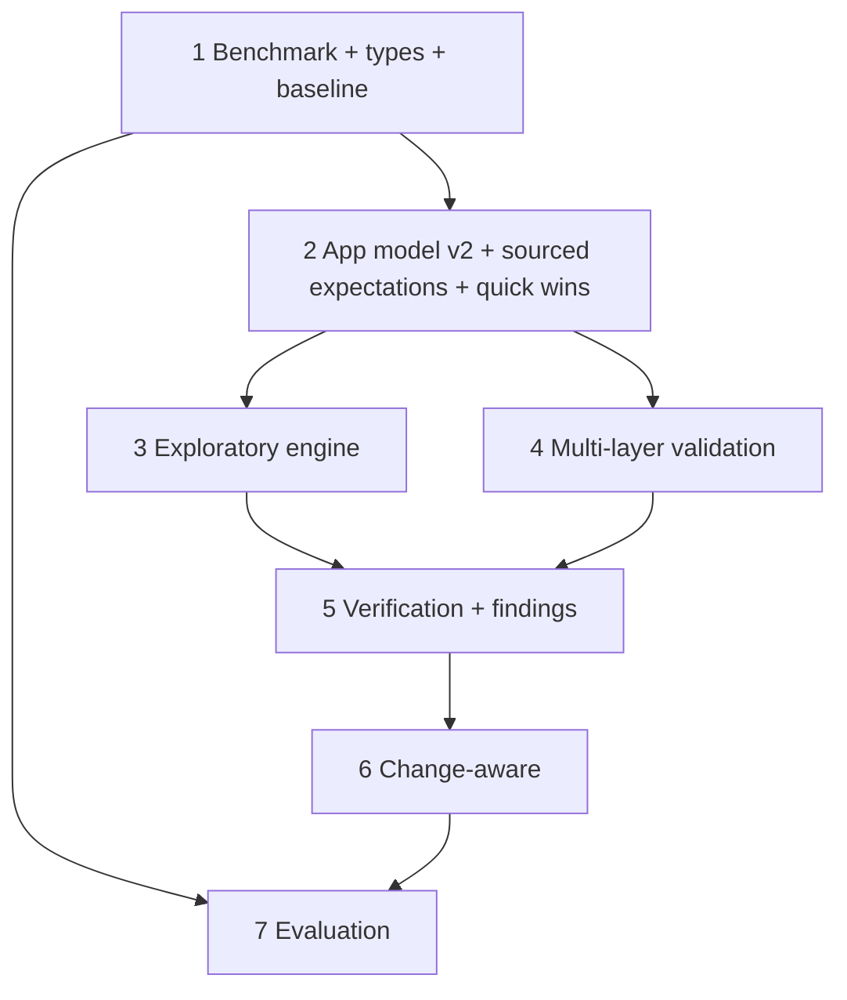

# Implementation roadmap

Phase 0 deliverable. Order follows value, dependencies and effort from `CAPABILITY_GAP_ANALYSIS.md`, inside the phase structure
of the plan (one phase at a time, each reviewed before the next). Effort: S < 1 week, M 1-3, L 3-6, XL > 6 (one engineer incl. tests).

## Guiding order

1. **Measure before changing.** The benchmark and a recorded baseline come first; without them no later change can be shown to help.
2. **Stop the engine from erasing bugs.** The cheapest, highest-value fixes are in authoring and repair: keep a failing sourced
   assertion, guard web repairs, re-execute defects. They ride on Phase 1-2 work and are measured against the baseline.
3. **Give expectations a source.** Application model v2 with rules and provenance (Phase 2) feeds every later oracle.
4. **Observe more than the screen, then explore deeper** (Phases 3-4).
5. **Make findings trustworthy and grouped** (Phase 5), then **continuous** (Phase 6), then **prove it** (Phase 7).

## Phase 1 — Foundation and benchmark (M-L)

| Step | What | Builds on | Effort |
|---|---|---|---|
| 1.1 | Seeded-defect fixture apps: checkout (calculation, quantity boundary, duplicate submit, persistence, coupon state) and sign-in/authorization (horizontal object access, role escalation, validation bypass); each defect switchable; clean variant | `examples/*` pattern, `examples/security-fixture` | M |
| 1.2 | Benchmark runner + metrics (found, missed, false positives on clean, reproduced, time, tokens); baseline vs candidate report; stored `benchmark_runs` | `src/eval/*`, `mutation/faults.ts` | M |
| 1.3 | Testing-intelligence types: expectation provenance, rule, observation, defect candidate (schema only, versioned app model table) | `spec/schema.ts`, `understanding/app-model.ts` | S-M |
| 1.4 | Test quality score with defined calculations (assertion strength, sourced-expectation share, boundary/negative coverage, stability, fault-replay result) — every number explained, no model score | `mutation/strength.ts`, eval metrics | S-M |
| 1.5 | Record the **baseline**: current engine on the fixtures with a real model (needs budget — open question 1) | — | S |

Exit: repeatable benchmark, a baseline number per defect class, documented limits.

## Phase 2 — Application intelligence (L)

| Step | What | Effort |
|---|---|---|
| 2.1 | Model v2: entities and fields (from forms, API schemas, response shapes), constraints (DOM attributes, OpenAPI), roles, workflows with steps, state transitions observed; versioned with diff | L |
| 2.2 | Rule extraction with provenance/confidence/status from requirements, OpenAPI and pages; person confirms or rejects (simple list in the existing project UI) | M |
| 2.3 | Requirement and rule text reaches the authoring agent (today it never does, `author.ts:559-577`); expectations carry their source | S |
| 2.4 | Quick wins measured against the baseline: keep a failing **sourced** assertion as a candidate finding; `weakensWebTest` guard; sourced assertions chosen on the strong model | S-M |
| 2.5 | Application Understanding view: sources connected, pages/workflows/endpoints, rules (confirmed / to confirm), missing context, last analysis | M |

## Phase 3 — Exploratory engine (L)

Bounded objective-driven loop on the existing objective agent: objectives from rules, workflows and coverage gaps; visited-state
tracking, budgets and stop conditions; input classes (empty, invalid, boundary from constraints, long, unicode); workflow
perturbations (repeat, back, refresh, out of order, double submit) under the authorization record; per-action observation log; candidate
findings with action sequence and evidence. Runs on the runner as a new explore mode. Web first; share objectives and findings with the
phone map explorer later.

## Phase 4 — Multi-layer validation (L, DB part XL)

Order inside the phase: (a) response assertions offered to authoring and UI-vs-API value correlation from the observation log (M);
(b) spec- and DOM-driven boundary and negative oracles replacing "status < 500" (S-M); (c) read-only horizontal object-level
authorization check with two accounts (M); (d) stateful API sequences with cleanup (M); (e) controlled concurrency / duplicate submission
with strict limits (M); (f) property-based inputs, deciding between fast-check and the existing seeded generator (M); (g) read-only
database invariants from the runner, only where a customer configures it (L-XL, last).

## Phase 5 — Verification, dedupe, root cause (M-L)

Generalised findings store from the security lifecycle (fingerprint, sightings, history); verification by N clean replays before
"confirmed"; deterministic classification (application / expectation / automation / infrastructure / network / environment / flaky)
with model explanation; duplicate grouping by endpoint+status, page+console signature, assertion+element; severity and confidence apart;
root cause labelled verified / supported / hypothesis / unknown using Sentry and source when present; evidence redaction audit;
findings shown in the existing results views and issue filing.

## Phase 6 — Change-aware testing (M-L)

Coverage map (test → pages, endpoints, rules); change impact from model diff, OpenAPI diff and, where connected, repository diff of a
pull request; risk-based selection with a reason per test, full run always available; fixed-bug regression linkage and re-verification;
quality history focused on findings, not dozens of metrics.

## Phase 7 — Evaluation and readiness (M)

Benchmark across engine versions with variance, missed-defect and false-positive analysis, cost per found defect, security and
reliability review of the new paths, UX pass, final documents.

## Dependencies

## Not in scope of these phases

PostgreSQL/S3 move and horizontal scaling (separate track); running external scanners on runners (separate decision, open question);
new desktop application (none: the runner stays the only local program).
