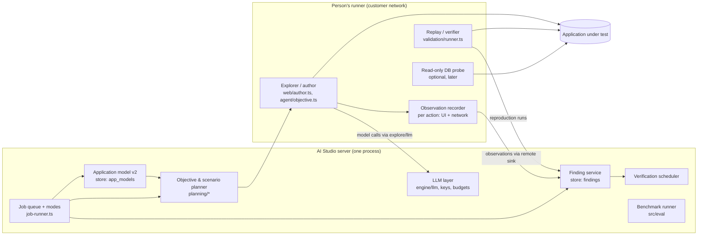

# Target architecture proposal

Phase 0 (§5 of the plan). The simplest architecture that turns AI Studio from a regression-test generator into an evidence-backed
bug finder, built on what exists. It follows from `CURRENT_STATE_AUDIT.md`, `EXISTING_INFRASTRUCTURE_MAP.md`,
`TEST_GENERATION_QUALITY_AUDIT.md` and `CAPABILITY_GAP_ANALYSIS.md`; claims about today's code are referenced there.

## 1. The problem this architecture solves

Today a generated web test is a record of what the application did while the test was written: the authoring agent keeps an
assertion only when it passes on the live page (`engine/web/author.ts:351-355`), a failing web test is re-authored until it passes
with no weakening guard (`engine/validation/repair.ts:66-112`; only API repairs are guarded, `:151,167`), and expectations carry no
source (`engine/spec/schema.ts:532-551`). The tests detect change, not defects that already exist. Everything else (shallow crawl,
UI-only observation, no finding entity, no bug-finding metric) compounds that.

The architecture therefore rests on one separation that does not exist today:

> **An expectation (what should happen, with its source) is separate from an observation (what did happen, with its evidence).
> A finding is a recorded mismatch between the two, verified by re-execution before anyone sees it as a bug.**

## 2. Principles

1. **No new services.** One server, one database, the existing job queue, the existing runner. New work is new job modes, new
   runner explore modes, new store files with their own migration slot, new `TestSpec` steps. (Facts: `generation_jobs` +
   `job-runner.ts` mode switch; runner protocol 2 explore modes; `GenerationSink`; `ObjectStore`.)
2. **Deterministic first, the model second.** Oracles, schema validation, invariant evaluation, input generation, fingerprints,
   deduplication and first-pass classification are code. The model is used where judgement on unstructured input is needed:
   reading requirements and pages into rules, choosing objectives, proposing scenarios, explaining evidence, and classifying what
   the rules cannot.
3. **A verdict comes from a check that ran.** Already the rule of the objective agent and the runner (`engine/agent/objective.ts`
   header); extend it to every finding: no finding is "confirmed" without a reproduction run.
4. **Every expectation has provenance.** `requirement | spec (OpenAPI/schema) | rule (confirmed by a person) | inferred (model) |
   observed (baseline)`. Only the first three may turn a mismatch into a likely defect; `inferred` gives a candidate needing
   confirmation; `observed` is regression only.
5. **Safe by default, deeper with explicit permission.** Data-changing, concurrent and database-reading work runs only with a
   project-level authorization record (reuse `security/authorization.ts` + `security/scope.ts`) and, for data changes, cleanup
   (`engine/cleanup/*`).
6. **Measured.** Every engine change is judged by the benchmark (§6) on seeded defects, not by pass rates.

## 3. Components and where they live

| Concern | Lives in | Reuses | New |
|---|---|---|---|
| Application model v2 (entities, fields + constraints, rules, states, roles, workflows; versioned) | server store + `AppModel` JSON | `understanding/*`, `screenmap/*`, `api/openapi.ts`, `requirements/*`, `identity/*`, `memory/diff.ts` | rule records with provenance/confidence/status; model versions; diff |
| Expectations with provenance | `TestSpec` / scenario schema | `spec/schema.ts`, planner | `expectation.source`, `ruleId`, `requirementId`, oracle kind |
| Authoring that can disagree with the app | runner (same engine code) | `web/author.ts`, interpreter, review | a sourced assertion that fails is **kept** and becomes a candidate finding, not retried away |
| Repair guard for web | engine | `weakensApiTest` pattern | `weakensWebTest`: a repair may not drop, loosen or retarget a sourced assertion |
| Observation log | runner → server artifact | `discovery/network.ts`, browser session events, `evidence/capture.ts` (redaction) | per-action record: action, URL, ARIA delta, request/response pairs (bodies redacted, size-capped), console |
| Oracles | engine, deterministic | `contracts/check.ts`, `remember`/`remembered`, `testdata/generate.ts` | computed invariants (sum of lines, counts), spec/DOM-limit boundaries, idempotency, UI-vs-API value match |
| Findings (functional + security, one model) | server store | `security/findings/*` (normalise, fingerprint, sightings, history) | generalised `findings` with kind, layer, expectation source, confidence, severity, lifecycle states |
| Verification | runner replay, scheduled by server | `validation/runner.ts`, `validate-only.ts`, flaky logic | N replays (clean context), classification by deterministic evidence first, LLM explanation last |
| Benchmark | `src/eval` + `examples/*` fixtures | eval harness, `mutation/faults.ts` | seeded-defect fixture apps, "found k of n / false positives / reproduced" metrics, baseline vs engine comparison |
| Change awareness | server | `memory/diff.ts`, `contracts/diff.ts`, `trigger-store.ts` commit SHA, runbooks | coverage map (test → pages/endpoints/rules), selection by changed areas |

## 4. Where each kind of work runs

- **Server:** all model calls (keys never leave it), application model, planning, finding storage, deduplication, verification
  scheduling, benchmarks' bookkeeping, reports and issue filing. It never opens a browser in the hosted mode
  (`EXECUTION_MODE=runners`).
- **Runner:** everything that touches the application: crawling, authoring, exploration, observation recording, replays,
  concurrency bursts, and (later, opt-in) read-only database probes. It reaches private networks and keeps no key.
- **Deterministic code:** oracles, invariant evaluation, boundary generation from schemas and DOM attributes, fingerprints and
  dedupe, first-pass failure classification, coverage and selection.
- **Model:** reading requirements and pages into candidate rules and entities; choosing exploration objectives; proposing
  scenarios and data; explaining a finding; classifying the remainder the rules cannot decide. Assertions on sourced expectations
  should be chosen on the strong model, not the fast one (`llm/routing.ts:43` routes authoring to fast today).

## 5. Data model additions (portable SQL, one migration slot per store)

- `app_model_versions` (project, version, created_at, source summary, model JSON, diff JSON) — the latest stays on `applications`.
- `app_rules` (project, model version, kind: invariant | constraint | transition | permission, text, structured form JSON,
  source, evidence JSON, confidence, status: proposed | confirmed | rejected) — a person can confirm or reject.
- `findings` + `finding_sightings` + `finding_history`, generalising `security_findings` (fingerprint unique per application;
  lifecycle: detected → candidate → verifying → reproduced → confirmed | unconfirmed | duplicate | flaky | environment |
  automation | needs_review; severity and confidence as separate fields; reproduction rate; links to tests, executions, artifacts,
  issues). Security findings migrate into it or stay and are read through one view (open question).
- Observation logs and reproduction bundles as artifacts in `ObjectStore` (`<project>/_artifacts/<job>/...`), not as rows.
- `benchmark_runs` (engine version, fixture, seeded defects, found, missed, false positives, reproduced, time, cost).

## 6. Measuring: the benchmark

- Fixture applications in `examples/` (owned, isolated, resettable) with seeded functional defects in at least checkout and
  sign-in/authorization flows, each defect a switch (environment variable or route flag) so one build serves "clean" and every
  "seeded" variant. Defect classes from the plan: calculations, validation, state transitions, authorization, duplicate
  operations, races, contract violations, persistence, boundaries, visual/interaction.
- A benchmark job runs the engine against each variant and records found / missed / false positive (a finding on the clean
  variant) / reproduced / time / tokens. Comparison is baseline engine vs candidate engine on the same fixtures and model.
- Limits stated in the report: fixtures are small and known; the model is non-deterministic (set temperature where supported,
  run several times, report spread); mutation-style scores are not real-world detection rates. Meaningful numbers need a real
  model and budget (open question).

## 7. Risks

| Risk | Mitigation |
|---|---|
| More false positives once assertions may disagree with the app | Only sourced expectations produce likely defects; every finding is re-executed; confidence shown apart from severity; benchmark tracks false positives on clean fixtures |
| Data-changing and concurrent testing harms a customer system | Authorization record per environment, production refused for mutating modes, budgets, cleanup, runner-side guards |
| One process + SQLite + one active job per project | Keep work bounded per job; benchmark runs outside customer projects; plan the PostgreSQL move separately (not required for these phases) |
| Cost and latency of more model calls | Budgets already exist; most new work is deterministic; measure cost per found defect in the benchmark |
| Model non-determinism hides real improvement | Multiple benchmark runs, fixed fixtures, temperature where allowed, report variance |
| Evidence now holds response bodies | Reuse redaction (`evidence/capture.ts`, `trace-scrub.ts`, frame secret cover); size caps; retention rules |
| Scope creep into a second agent framework | Extend the objective loop and the authoring loop; no new orchestration layer |
